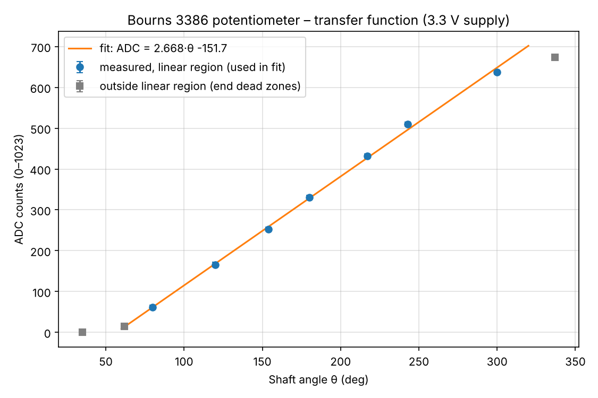
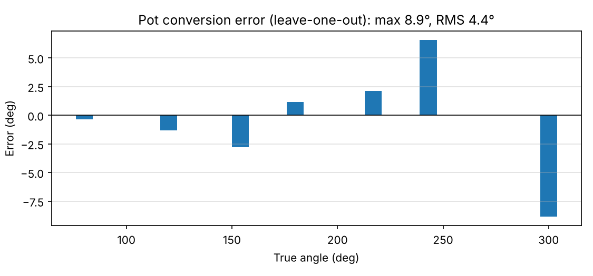
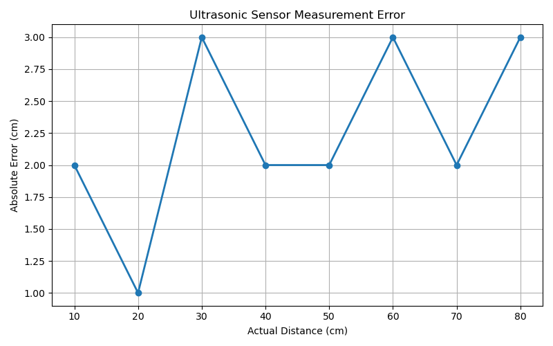
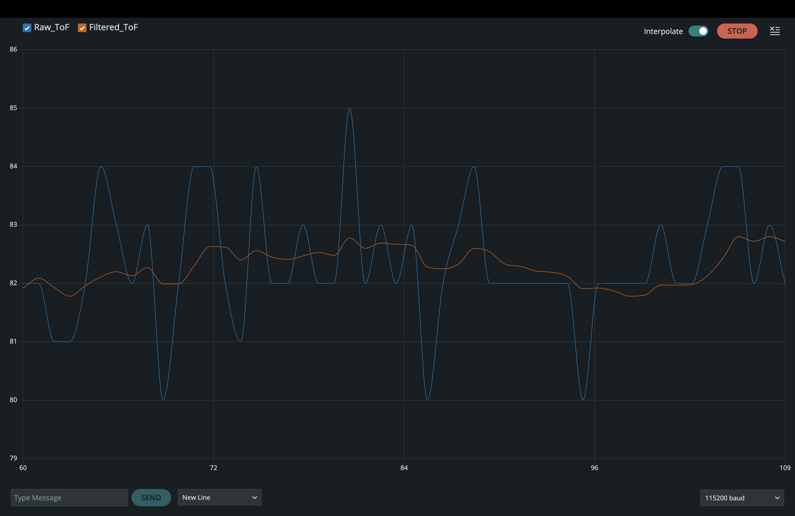

# Sensors and Motor Control Lab

Five-person team project for Systems Engineering 16-650, TSP05. The system combines
four sensors and three motors on one Arduino Uno, with a laptop ROS 2 serial
bridge and an rqt control/display panel.

The unified firmware is in
[`Unified_Sensors_Motors/`](Unified_Sensors_Motors/). Open
[`Unified_Sensors_Motors.ino`](Unified_Sensors_Motors/Unified_Sensors_Motors.ino)
to build/upload it. That folder contains all application firmware source files;
the original teammate folders provide source history, calibration, and standalone
experiments.

## Repository layout

| Folder | Role |
|---|---|
| [`Unified_Sensors_Motors/`](Unified_Sensors_Motors/) | Combined Uno application: sensor processing, all motor controllers, mode/button handling, and serial protocol v1. |
| [`sensor_gui/`](sensor_gui/) | ROS 2 Humble serial bridge, rqt dashboard, serial-device simulator, launch file, and integration tests. |
| [`arduino/TSP05_Motor_Control/`](arduino/TSP05_Motor_Control/) | Original integrated prototype; ultrasonic/stepper logic supplies that portion of the unified firmware. |
| [`dc_control_ir/`](dc_control_ir/) | Original DC encoder PID/PI controller, IR-driven PWM controller, component tests, and documentation. |
| [`pot_servo/`](pot_servo/) | Potentiometer/servo calibration and control, measured data, transfer/error plots, and plotting script. |
| [`tof_filter/`](tof_filter/) | Original VL53L1X raw/filtered ranging experiment and exponential filter. |

## System and current status

| Sensor | Sensor-mode behavior | GUI feedback |
|---|---|---|
| Potentiometer | Commands servo angle | ADC, calibrated/raw and filtered angle, servo command |
| Sharp IR rangefinder | Selects forward DC PWM | ADC, voltage, distance, detection, requested PWM |
| Analog ultrasonic | Commands stepper target | ADC, raw and filtered distance, stepper estimate/target |
| VL53L1X ToF | Display/filtering only | Raw and filtered millimeters, sample identity/time, validity |

GUI control provides servo angle, DC relative position/velocity, and stepper
relative angle commands. A debounced physical button or a serial command switches
GUI/sensor mode. The serial format is defined below.

The Uno firmware compiles and its desktop logic tests have passed. The ROS 2
package and rqt dashboard are implemented, with simulated ROS/GUI and serial
pseudo-terminal integration tests. Physical integration testing remains. The
data path is:

```text
Sensors/motors ↔ Arduino Uno ↔ USB serial ↔ laptop ROS 2 node ↔ ROS topics ↔ GUI
```

The bridge owns the serial port, publishes physical-unit telemetry and validity/
mode state, serializes commands while waiting for ACK/ERR, and discards commands
after connection failures rather than replaying relative moves. The rqt panel
provides motor controls, mode/stop controls, sensor and motor state displays,
paired raw/filtered ToF plots, a DC velocity plot, and labelled ToF CSV export.
Physical tests and remaining assignment evidence are listed at the end of this README.

## Sensor measurements and lab evidence

### Potentiometer transfer function

The lab requires a transfer-function plot based on our own measurements, with
the physical quantity on the x-axis and raw electrical output on the y-axis.
For the potentiometer, reference shaft angles were measured with a protractor,
and 50 ADC readings were collected at each of ten positions. The plot shows
shaft angle in degrees against mean ADC counts, with measured ADC standard
deviation as error bars.



The seven points in the usable **80–300°** region give the fitted relationship
`ADC = 2.668 × angle_deg − 151.7`. The inverse conversion used by the firmware is
`angle_deg = 0.37486 × ADC + 56.877`. Gray points show the end dead zones excluded
from the fit. These measurements use a **3.3 V potentiometer supply** with the
Uno's default ADC reference.

Calibration measurements: [`pot_cal.csv`](pot_servo/data/pot_cal.csv).
Fit and plot generation: [`make_figures.py`](pot_servo/scripts/make_figures.py).

### Potentiometer conversion error

The following plot reports estimated angle-conversion error over the usable
range. Leave-one-out validation fits a line to six calibration points and
predicts the seventh, repeating this for every point. Error is predicted angle
minus reference angle; this is validation on held-out calibration points, not
a separate independently collected test set.



The **maximum absolute error is 8.9°** and **RMS error is 4.4°**. The largest
errors occur near the ends of the fitted range. The calibration procedure,
measurement limitations, and challenges are documented in
[`pot_servo/README.md`](pot_servo/README.md).

### Sharp IR Sensor Calibration and Conversion Error

The Sharp GP2Y0A21YK IR sensor provides an analog voltage that varies
with the distance to a reflective object. To obtain distance readings
in physical units, we experimentally calibrated the sensor using
objects placed at known distances.

At each calibration distance, the sensor's output voltage was recorded.
The measured voltage-distance pairs were used to obtain a linear
least-squares fit:

`distance_cm = -23.4382 × voltage_V + 76.6889`

The resulting conversion is used by the Arduino firmware to estimate
distance in centimeters. The calculated distance is clamped to the
sensor's specified operating range of **10–80 cm**.

#### Calibration measurements and conversion error

The conversion error was evaluated by applying the fitted equation
to the calibration voltage readings and comparing the resulting
distances against the corresponding reference distances.

| Actual distance (cm) | Measured voltage (V) | Calculated distance (cm) | Absolute error (cm) |
|---:|---:|---:|---:|
| 10 | 2.80 | 11.06 | 1.06 |
| 20 | 2.50 | 18.09 | 1.91 |
| 30 | 1.98 | 30.28 | 0.28 |
| 40 | 1.48 | 42.00 | 2.00 |
| 50 | 1.20 | 48.56 | 1.44 |

The mean absolute error across these calibration points is **1.34 cm**,
with a maximum absolute error of **2.00 cm**.


### Ultrasonic Sensor Calibration and Conversion Error

Ultrasonic sensor was used to measure object
distance and control the stepper motor.

Measurement error was calculated using:

`Error = Measured distance - Actual distance`

`Absolute error = |Error|`

`Percentage error = (Absolute error / Actual distance) × 100`

#### Ultrasonic distance error table

| Actual (cm) | Measured (cm) | Error (cm) | Absolute error (cm) | Error (%) |
|---:|---:|---:|---:|---:|
| 10 | 12 | +2 | 2 | 20.00 |
| 20 | 21 | +1 | 1 | 5.00 |
| 30 | 27 | -3 | 3 | 10.00 |
| 40 | 38 | -2 | 2 | 5.00 | 
| 50 | 48 | -2 | 2 | 4.00 | 
| 60 | 57 | -3 | 3 | 5.00 | 
| 70 | 68 | -2 | 2 | 2.86 | 
| 80 | 77 | -3 | 3 | 3.75 | 

The experimentally measured points gave a mean absolute
error of 2.25 cm and a mean absolute percentage error of 6.95%.


#### Error plot



The plot shows absolute distance error against actual distance.

#### Stepper motor integration

The ultrasonic distance is filtered using exponential moving
average smoothing with alpha = 0.1.

Distances between 15 and 75 cm are mapped to stepper target
angles between 0 and 180 degrees. A 50-step deadband reduces
unnecessary movement caused by fluctuations in sensor readings.


### ToF filtering: raw and filtered readings together

The lab requires raw and filtered sensor data to be shown together to demonstrate
noise reduction. The supplied Serial Plotter capture compares `Raw_ToF` (blue)
with `Filtered_ToF` (orange) from the VL53L1X filtering experiment.



The filter uses **α = 0.1** and the **ten most recent valid samples**, with older
samples weighted by successive powers of `0.9` and the weights normalized to
sum to one. The nominal sample interval is **100 ms**, giving approximately one
second of history when readings are valid. The smoother orange trace shows
reduced short-term variation compared with the blue raw trace. Smoothing also
slows the response to changes in distance.

The [ToF sketch](tof_filter/sensors.ino) reports distances in millimeters; the
screenshot does not label elapsed time. This figure demonstrates filtering,
while measurement error against known distances over the ToF's usable range
remains a separate requirement. Filter implementation:
[`ExponentialFilter.cpp`](tof_filter/ExponentialFilter.cpp).

## Start the ROS 2 dashboard

From the repository root:

```sh
source /opt/ros/humble/setup.bash
colcon build --base-paths sensor_gui --symlink-install
source install/setup.bash
ros2 launch sensor_gui lab.launch.py simulate:=true
```

This starts synthetic data for GUI development; it is not sensor calibration
evidence. To connect to the Uno, stop simulation and run:

```sh
ros2 launch sensor_gui lab.launch.py port:=/dev/ttyACM0
```

Upload the unified firmware first and close Arduino Serial Monitor/Plotter.
The bridge waits for startup and protocol-v1 telemetry before enabling commands.
See [`sensor_gui/README.md`](sensor_gui/README.md) for dependencies, topic names,
command behavior, plotting/capture, reconnect/shutdown behavior, and tests.

## Source modules

| Source | Retained behavior |
|---|---|
| `arduino/TSP05_Motor_Control/` | Only analog ultrasonic conversion, EMA, and step/direction stepper control: 15–75 cm maps to 0–180°, 50-step target deadband, 1600 steps/rev, minimum 5000 µs between steps. |
| `pot_servo/firmware/pot_servo_control/` | Eight-read ADC average, measured angle conversion, EMA α=0.3, 80–300° pot range mapped to −90…+100° servo range, 610–2500 µs endpoint interpolation. |
| `dc_control_ir/position_velocity_control/` | Encoder interrupt method and 12375.12 counts/rev; position PID (3, 0.05, 0.2), ±1.5° tolerance; velocity PI (4, 3), anti-windup, deadband, ±12 RPM and original PWM limits. |
| `dc_control_ir/ir_control/` | Ten-read average, measured distance approximation, 10–80 cm clamp, six original PWM levels, 2 cm hysteresis, 0.30/0.35 V detection hysteresis. |
| `tof_filter/` | VL53L1X long mode, 50 ms measurement budget/continuous interval, valid samples only, normalized exponential weighting (α=0.1) over the latest ten accepted samples. No motor association. |

Integration changes: modules share one scheduler and serial interface; IR samples
are collected 5 ms apart without `delay()`; ToF readiness is polled before
`read(false)`; sensor initialization failures do not halt the motor loop; encoder
snapshots preserve interrupt state; PID output is clamped before conversion to the
Uno's 16-bit integer. Small timestamped telemetry frames drain through UART only
when space is available. There are no dynamically allocated `String` objects.
Short 10 µs direction-setup and 5 µs STEP pulses remain from the stepper code.

The original DC sketches are two distinct control paths. **GUI DC control uses
encoder feedback; IR sensor control directly applies PWM in the forward direction.**
IR mode is not an encoder velocity controller. The assignment permits this sensor
control behavior, while the GUI must demonstrate closed-loop position/velocity.
IR PWM is not constrained to the PID's limit of 180.

## Wiring and configuration

| Device | Uno connection |
|---|---|
| Encoder A / B | D2 / D3, external encoder pull-ups as in the lab instructions |
| EasyDriver STEP / DIR | D4 / D5 |
| L298 enable PWM / IN1 / IN2 | D6 / D7 / D8 |
| Servo signal | D9 |
| Pushbutton | D12 to GND; `INPUT_PULLUP`, 40 ms software debounce |
| Potentiometer wiper | A0; retain **3.3 V** potentiometer supply |
| Analog ultrasonic output | A1 |
| Sharp IR output | A2 |
| VL53L1X SDA / SCL | A4 / A5; use the actual breakout's specified supply/logic interface |

The servo moves from the old integrated sketch's D3 to the calibrated subsystem's
D9, and the button moves from D7 to D12. Servo uses Timer1, so D9/D10 cannot provide
DC PWM; D6 remains available. D0/D1 are reserved for USB serial. Use the default
5 V ADC reference; changing the reference or pot supply invalidates calibration.
Connect motor power externally with common ground, and retain the driver current
limits and encoder pull-ups required by the lab.

[`Unified_Sensors_Motors/Config.h`](Unified_Sensors_Motors/Config.h) holds pins,
timing, original tuning, and calibration constants. Verify
1600 step pulses per shaft revolution against the actual EasyDriver microstep
configuration, and verify encoder scale/polarity before testing PID.

## Build the Arduino firmware

Dependencies tested: Arduino AVR Boards **1.8.6** (or a compatible core with Wire
timeouts), Arduino **Servo 1.3.0**, and Pololu **VL53L1X 1.3.1**. Select the Pololu library, not a different
VL53L1X API. The integration uses its documented `dataReady()` and `read(false)`
methods: <https://github.com/pololu/vl53l1x-arduino>.

With Arduino CLI installed, from the repository root:

```sh
arduino-cli core install arduino:avr@1.8.6
arduino-cli lib install Servo@1.3.0 VL53L1X@1.3.1
arduino-cli compile --fqbn arduino:avr:uno Unified_Sensors_Motors
```

Only upload after checking the pin map and power arrangement. The local desktop
simulation tests live in `Unified_Sensors_Motors/tests/` and run with
`bash Unified_Sensors_Motors/tests/run.sh` when that directory is present. These
tests are currently excluded from Git by `.gitignore`.
They exercise logic/protocol behavior, not motor tuning, electrical wiring, or
real sensor accuracy.

Verified Uno build: **20850/32256 bytes flash** and **1214/2048 bytes static RAM**,
leaving 834 bytes for stack/local variables. No upload or physical motor/sensor
test has been performed as part of this integration. Desktop tests cover filter
weighting, calibrated limits, step rounding/partial motion, encoder-relative
commands, IR hysteresis, ToF invalid/stale/error handling, serial validation and
framing, mode transitions, latched stop, button debounce, and UART backpressure.

## Modes and commands

115200 baud, ASCII, newline-terminated. CRLF is accepted. Commands are uppercase.
Only the laptop's serial bridge should own the port. Send one command at a time,
wait for `ACK` or `ERR`, and accept interleaved telemetry while waiting. Commands
must contain at most 47 printable characters before the newline; malformed or
overlong lines are discarded in full. Empty lines are ignored. A trailing newline
is mandatory. Do not send continuous unacknowledged command bursts.

At boot the system is in **GUI** mode: DC stopped, stepper origin defined as its
current physical position (0°), servo commanded to 0° using the original pulse
interpolation. There is no homing or absolute-position sensor on the stepper.

| Command | Effect / reply |
|---|---|
| `MODE,GUI` | Stop DC/cancel unfinished stepper movement, hold servo command, give GUI control. `ACK,MODE,GUI`. |
| `MODE,SENSOR` | Pot→servo, IR→DC PWM, ultrasonic→stepper; DC waits for a fresh IR batch. `ACK,MODE,SENSOR`. |
| `SERVO,-90` | Absolute servo angle, clamped to −90…+100°. `ACK,SERVO,<applied_deg>`. |
| `DC_POS,-30` | Relative to current encoder position; replaces the previous DC operation. ±3600° per command. `ACK,DC_POS,<requested_deg>`. |
| `DC_VEL,-5` | Signed RPM, clamped to ±12. Zero stops DC. `ACK,DC_VEL,<applied_rpm>`. |
| `STEPPER,45` | Relative to current estimated position; replaces any pending move. ±360° per command. `ACK,STEPPER,<rounded_deg>`. |
| `STOP` or `STOP,ALL` | DC output zero, stepper target=current, servo holds its last command. Enter **STOPPED**. `ACK,STOP,STOPPED`. |

Motion commands are rejected outside GUI mode. `MODE,GUI` or `MODE,SENSOR` explicitly
leaves STOPPED; a button press leaves STOPPED for GUI. Otherwise the button toggles
GUI↔SENSOR. STOP remains latched until such an explicit mode action. It is a
software motion stop, not a power-disconnect or servo torque release. Neither
serial disconnect nor lack of commands automatically stops a running motor.
Repeated requests for the already active mode do not cancel motion.

For convenience `POS,<deg>` and `VEL,<rpm>` remain aliases for the original DC
commands. `M0` means SENSOR and `M1` means GUI, matching `pot_servo` (the original
servo/stepper sketch used the reverse numbering). Prefer named MODE commands.

Numeric commands reject missing values, NaN, infinity, and trailing junk. `ERR`
reasons are `NUMBER`, `RANGE`, `COMMAND`, `LINE`, `SENSOR_MODE`, or `STOPPED`.
An absolute stepper target beyond ±100000000 steps is rejected to avoid overflow.

Example session:

```text
MODE,GUI
SERVO,-90
SERVO,100
DC_POS,30
DC_VEL,-5
DC_VEL,0
STEPPER,-30
MODE,SENSOR
STOP
```

Wait for each ACK before sending the next line, and allow a position move to finish
before issuing a replacement if the goal is to observe completion.

## Telemetry protocol v1

Boot emits `READY,UNIFIED_SENSORS_MOTORS,1`. Seven independently timestamped CSV
record types are scheduled approximately every 100 ms. Timestamps are Arduino
`millis()` values (unsigned 32-bit, wrap after about 49.7 days), not wall-clock time.
Packets are sent one at a time; they are not one atomic snapshot. Commands/replies
take priority over the next telemetry packet. Treat missing/stale packets in the
GUI explicitly. Fields always appear in the following order:

```text
SYS,ms,mode,protocol_version
POT,ms,adc_mean_truncated,pot_deg,pot_filtered_deg,servo_command_deg
IR,ms,adc_mean,volts,distance_cm,detected,requested_pwm
ULTRA,ms,adc,raw_cm,filtered_cm
TOF,ms,sample_seq,sample_ms,raw_mm,filtered_mm,valid,range_status,online
DC,ms,control_mode,position_deg,velocity_rpm,target_position_deg,target_rpm,applied_pwm
STEPPER,ms,position_steps,target_steps,position_deg,target_deg,rounded_move_deg,moved_deg,moving
```

- SYS mode is `GUI`, `SENSOR`, or `STOPPED`.
- Servo angle is a **command**, not measured shaft feedback. Preserve this label
  in the GUI. The endpoint interpolation puts a 0° command at about 1505 µs, as
  in the original code; the calibration README rounds this to 1500 µs.
- IR `detected=0` means `distance_cm=-1` and `requested_pwm=0`. Requested IR PWM
  is calculated in every mode; the DC packet reports the PWM actually applied.
- ULTRA `raw_cm` is the nominal `adc*1.27` conversion; filtered uses α=0.1.
  Neither the ultrasonic nor pot/IR ADC input can reliably distinguish a
  disconnected wire from a plausible value using this code alone.
- TOF `sample_seq` increments only for new valid filtered samples. For plots and
  filter data collection use `sample_ms`, **deduplicate sample_seq**, and require
  `valid=1`/`online=1`. `ms` is the transmission timestamp. Do not treat duplicate
  packets as new sensor samples. A nonzero range status marks an invalid reading;
  the filter is not updated. `-1` means initialization/I²C error; `-2` means no
  fresh ranging result within 500 ms (or waiting for the first result). Initial
  values are −1. After failure, retained values are historical and must not be
  presented as current measurements. A failed I²C device is disabled until reset;
  no blocking reinitialization runs during motor control. The I²C bus timeout is
  3 ms per transaction; the scheduler is cooperative rather than hard real time.
- DC mode is `IDLE`, `POS`, `VEL`, or `IR`. Target position is meaningful in POS;
  target RPM in VEL. In IR use `IR.requested_pwm` and `DC.applied_pwm`. PWM is
  signed to show direction. Position is relative to boot and remains in POS
  while holding within the original ±1.5° tolerance.
- Stepper positions are **estimates from issued pulses**, not physical feedback.
  A 1600-step revolution gives 0.225° resolution. `rounded_move_deg` is the
  achievable signed angle for the latest move; `moved_deg` is the signed pulse
  count since that move began, including partial moves and cancellation. At
  completion they match. Sensor retargeting begins a new move record. Missed
  steps/slip cannot be detected; the GUI must not label the estimate as measured.

<!-- ## Assignment evidence still needed

This selection supplies four different sensors, including analog sensors, and
three distinct sensor→motor pairings for a five-person team. The existing pot
transfer plot, leave-one-out error analysis, and ToF raw/filtered comparison are
embedded in the sensor-evidence section above.
Before the demo, collect measured error over the usable range for IR, ultrasonic,
and ToF; test GUI control and sensor control on all three physical motors; show
the debounced button; document the
integrator's contribution/challenges and the project application. GUI/ROS
implementation is present, but the complete hardware demonstration and motor
mounting/visible shaft markers remain to be verified.

Known original limitations retained rather than retuned:

- IR's 220-PWM band is unreachable from its initial state: distance is clamped
  to ≥10 cm but entering level zero requires `<10−2=8 cm`. The practical highest
  band is 190. The linear distance approximation still needs measured error;
  clamping does not validate accuracy or extend physical detection range.
- The ultrasonic target deadband is 50 steps = 11.25°, so small distance changes
  do not move its stepper target. Sensor-mode position is referenced to the boot
  origin, not to the position where SENSOR mode was entered.
- The original minimum velocity PWM is 55. Very low RPM commands may be physically
  unachievable at that PWM; demonstrate achievable velocities after hardware testing.
- Pot calibration sketch comments mention 5 V wiring, while its measured data,
  final controller, and transfer plot specify a 3.3 V supply. This integration
  follows the final calibrated controller and leaves those source files intact. -->
