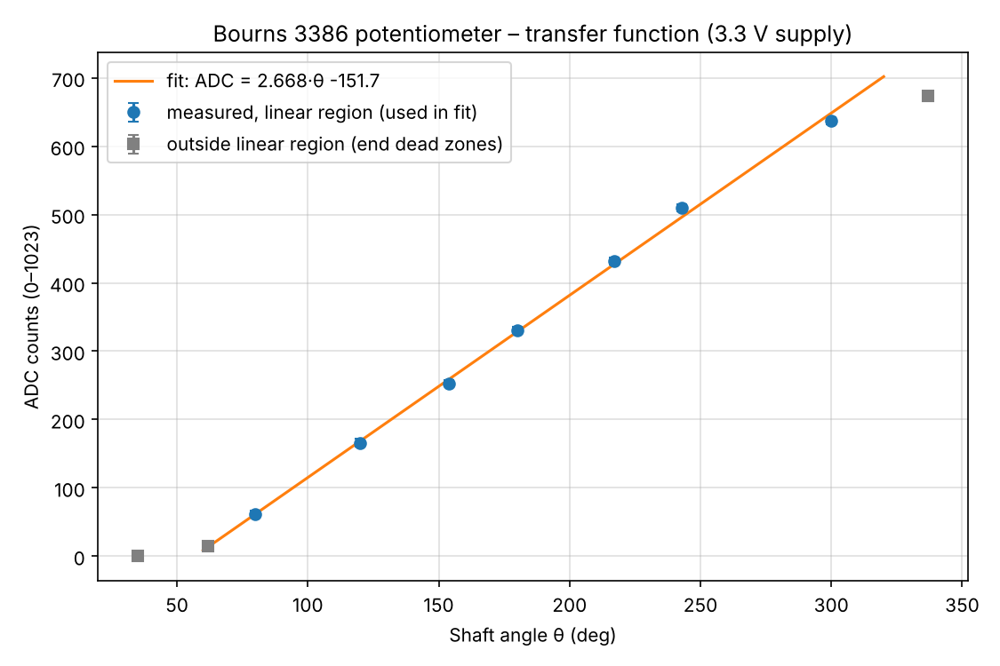
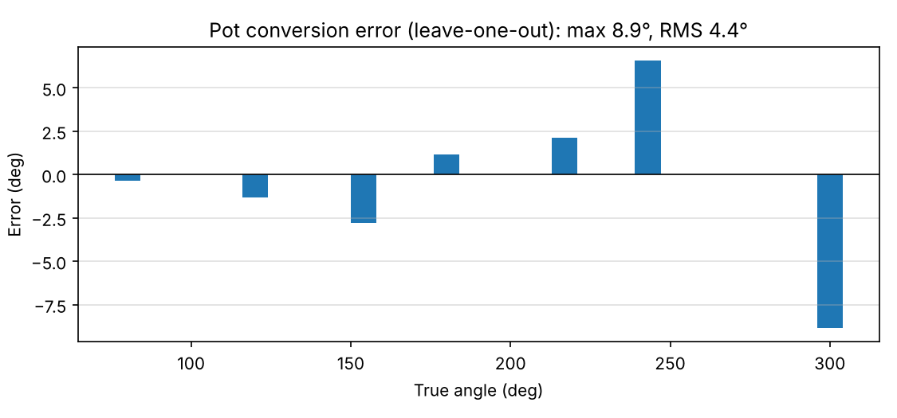

# Potentiometer → RC Servo (sensor + GUI control)

**Author:** _your name / GitHub username_
**Lab requirements covered:** sensor in physical units with measured error (1), transfer function plot (2), filtering (3), RC servo GUI control to both limits and any angle (4), sensor-driven motor (5).

## Hardware

| Part | Connection |
|---|---|
| Bourns 3386 10 kΩ single-turn trimmer pot | pin 1 → 3.3 V, pin 3 → GND, **pin 2 (wiper) → A0** |
| Hitec HS-311 RC servo | signal → **D9**, red → external 5–6 V supply, black → supply GND, **supply GND tied to Arduino GND** |

D9 was chosen because the Arduino Servo library disables PWM on pins 9 and 10 anyway, which keeps D2/D3 (the Uno's only external-interrupt pins) free for the DC motor encoder. The servo is powered externally because its current spikes can reset the Uno.

_Add a wiring photo or schematic here: `figures/wiring.jpg`_

## How it works

1. **Read:** 8 ADC samples on A0 are averaged per reading (20 Hz loop, no blocking `delay()`).
2. **Convert to degrees:** `angle = 0.37486 × ADC + 56.877`, a linear fit to my own protractor measurements (below).
3. **Filter:** exponential moving average, `filt = 0.3·raw + 0.7·filt`, to suppress ADC spikes.
4. **Map to the servo:** in sensor mode, the pot's usable range 80–300° maps linearly onto the servo's full range −90° to +100°.
5. **Drive the servo in real degrees:** degrees are converted to a pulse width from the measured servo calibration (610 µs = −90°, 1500 µs = 0°, 2500 µs = +100°, about 10 µs/deg) and sent with `writeMicroseconds()`.

## Calibration

### Potentiometer (transfer function)
A paper protractor was fixed under the trimmer with a pointer on the slot. The ADC was averaged over 50 samples at each of 10 angles across the full rotation (`firmware/pot_calibration`, raw data in `data/pot_cal.csv`).



- **Transfer function (linear region 80–300°):** ADC = 2.668 · θ − 151.7 counts
- **Usable range:** 80–300°. Below about 70° and above about 300° the output is flat (end dead zones of the track), so those points are excluded from the fit.
- **Noise:** about ±5 counts (±2°) on single raw samples, with occasional +15–20 count spikes. These are removed by the averaging and the EMA filter.

### Conversion error
The error was estimated by **leave-one-out validation**: each calibration point is predicted by a line fitted to the other six, so no point is checked by a fit that has seen it.

| True angle (°) | Error (°) |
|---|---|
| 80 | −0.3 |
| 120 | −1.3 |
| 154 | −2.8 |
| 180 | +1.2 |
| 217 | +2.1 |
| 243 | +6.6 |
| 300 | −8.9 |
| **Max / RMS** | **8.9° / 4.4°** |



### Servo
Using `firmware/servo_calibration`, the pulse width was stepped in 50 µs, then 10 µs, increments toward each end until the horn stopped moving, and the horn angle was measured with a protractor:

| Pulse (µs) | Angle |
|---|---|
| 610 | −90° (ACW limit) |
| 1500 | 0° |
| 2500 | +100° (CW limit) |

The response is linear (9.9 µs/deg on one side, 10.0 µs/deg on the other), so the code interpolates every angle between the two limits. Pulses above 2500 µs were not used, to avoid driving the gears into the internal stop.

## Serial interface (for the ROS 2 node / GUI)

115200 baud. **Only one program can have the port open**, so the ROS 2 node owns the port and the GUI reads and writes ROS topics, not the serial port.

**Arduino → laptop**, one CSV line at 20 Hz:
```
pot_adc,pot_deg,pot_deg_filt,servo_cmd_deg,mode
```
| Field | Unit | Meaning |
|---|---|---|
| pot_adc | counts | raw averaged ADC (0–1023) |
| pot_deg | deg | pot angle, unfiltered |
| pot_deg_filt | deg | pot angle after EMA filter |
| servo_cmd_deg | deg | angle the servo is being commanded to (−90 to +100) |
| mode | 0/1 | 0 = sensor control, 1 = GUI control |

**Laptop → Arduino**, newline-terminated:
| Command | Effect |
|---|---|
| `M0` | sensor mode (pot drives the servo) |
| `M1` | GUI mode |
| `S<deg>` | servo target in GUI mode, e.g. `S-90`, `S0`, `S100` (clamped to −90…100) |

When this is merged into the team's single sketch, these fields and commands will become part of the combined protocol, so the names may get a prefix.

## Challenges

1. **A nonlinear transfer curve on the first attempt.** The first calibration only went to 180° and showed a slope that kept increasing (1.2 → 4.4 counts/deg), which suggested a log-taper pot. The Bourns 3386 datasheet showed it is a cermet trimmer (linear, 280° effective / 310° mechanical), so I re-measured the whole rotation from end stop to end stop. The second run was linear from 80° to 300° (2.67 counts/deg). The curvature in the first run came from measuring only part of the range and from the end dead zone at the low end.
2. **The full scale only reached about 673 counts (3.3 V) instead of 1023.** The pot is supplied from 3.3 V while the ADC reference is 5 V, so only about 65% of the ADC range is used: about 0.37° per count instead of about 0.27°, which is still well below the measurement error. Because the pot and the ADC reference are on different supplies, the reading is not ratiometric, so USB 5 V variation (±5%) appears as gain error. Moving the pot to 5 V would fix both but needs a recalibration. I kept 3.3 V and calibrated with it.
3. **Angle measurement on a small trimmer.** Reading a screwdriver slot against a paper protractor limits accuracy to roughly ±2–3°, and the protractor's zero was not exactly at the end stop (the measured angles go past the 310° mechanical spec). The largest errors (+6.6°, −8.9°) are at the ends of the range, where the leave-one-out point lies outside the remaining points. Improvements would be a long pointer on the shaft and a printed dial centered on it.
4. **ADC spikes.** Isolated +15–20 count jumps appeared in the raw stream. 8-sample averaging plus the EMA (α = 0.3) removes them, at the cost of about 0.1–0.2 s of lag when the knob is turned quickly. A 0.1 µF capacitor from A0 to GND would reduce the noise in hardware.

## Files
```
firmware/pot_servo_control/   final sketch (pot→servo, GUI commands, CSV output)
firmware/pot_calibration/     pot data collection (type angle → averaged ADC)
firmware/servo_calibration/   servo pulse-width sweep
data/pot_cal.csv              pot calibration measurements
scripts/make_figures.py       fit, transfer-function plot, leave-one-out error
figures/                      plots (+ wiring photo)
```
